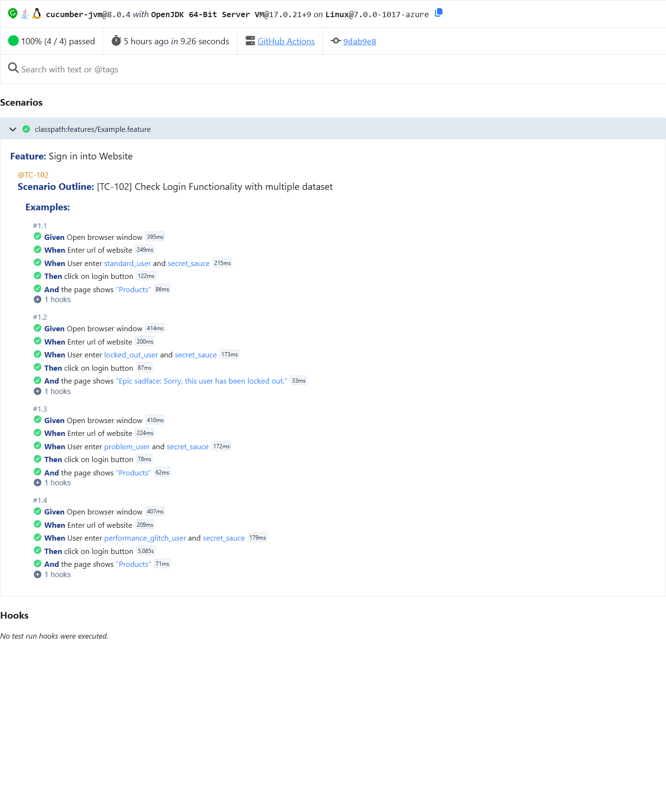
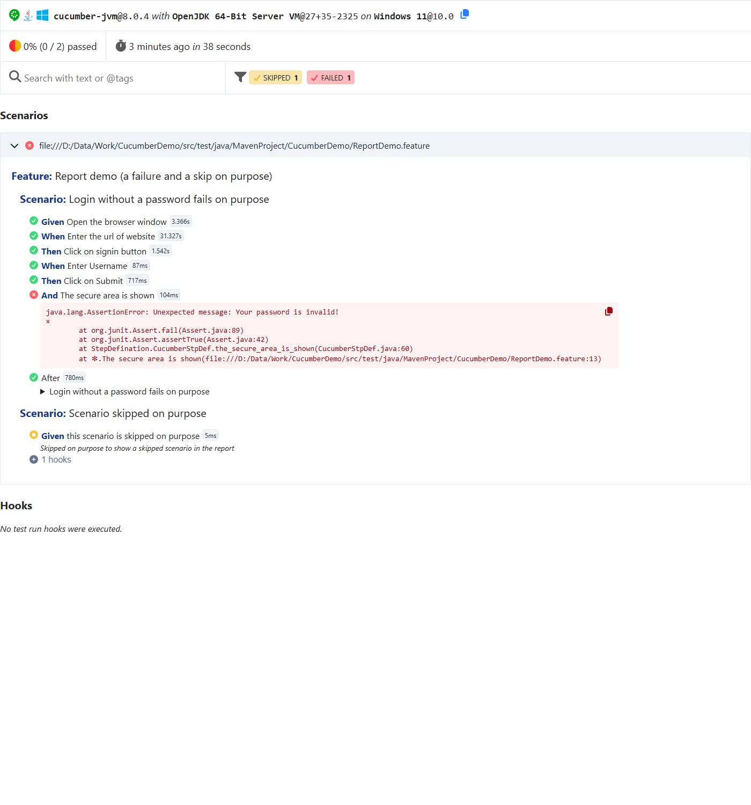

# Cucumber BDD Demo

Cucumber + Selenium BDD project, first written in April 2022 while learning Cucumber, then
upgraded step by step in October 2026 to Java 17, Cucumber 8 and Selenium 4, and then split into
clear layers without changing its logic: runners → features → step definitions → page objects →
browser and config helpers. The commit history shows every step.

- Layered: runners, step definitions, page objects, hooks and utils in their own packages,
  feature files and settings in `src/test/resources`.
- Two features: a login on a public practice site, and a Scenario Outline that logs in four
  Sauce Demo users and checks the result each one must get.
- Cucumber hooks: one browser per scenario, always closed, a screenshot attached on failure.
- Browser, headless mode, URLs and waits from `config.properties`, overridable with `-D`.
- Cucumber HTML and JSON reports per runner, plus a report demo with a failure and a skip on purpose.

## Contents

- [Stack](#stack)
- [Project structure](#project-structure)
- [The layers](#the-layers)
- [How a run works](#how-a-run-works)
- [The features](#the-features)
- [Configuration](#configuration)
- [Setup and run](#setup-and-run)
- [Reports](#reports)
- [Report demo: a failure and a skip on purpose](#report-demo-a-failure-and-a-skip-on-purpose)
- [What changed since the 2022 version](#what-changed-since-the-2022-version)
- [Known limitations](#known-limitations)

## Stack

| Part | Version |
|---|---|
| Java | 17 (tested on 27) |
| Cucumber | 8.0.4 (cucumber-java, cucumber-junit-platform-engine) |
| Runner | JUnit Platform 6.1.3: each runner is a `@Suite` that runs one feature file with the Cucumber engine |
| Selenium | 4.51.0 (Selenium Manager downloads the browser driver) |
| Reports | Cucumber HTML + JSON (Jackson 2.22 for the JSON writer) |
| Build | Maven, Surefire 3.5.6 |
| Sites under test | [the-internet.herokuapp.com](https://the-internet.herokuapp.com) and [saucedemo.com](https://www.saucedemo.com) (public practice sites) |

## Project structure

```
pom.xml
src/test/resources/
  config.properties                 browser, headless, waitSeconds, site URLs, practice-site login
  features/
    cucumber.feature                practice-site login
    Example.feature                 Sauce Demo login outline (4 users + expected result)
    ReportDemo.feature              a failure and a skip on purpose
src/test/java/com/niranjankagri/cucumberdemo/
  runners/
    TestRunner.java                 runs features/cucumber.feature
    ExampleRunner.java              runs features/Example.feature
    ReportDemoRunner.java           runs features/ReportDemo.feature (excluded from mvn test)
  stepdefinitions/                  glue: Java code behind the Gherkin steps (no locators)
    CucumberStpDef.java             steps of cucumber.feature
    ExampleStpDef.java              steps of Example.feature
    DemoStpDef.java                 the "skipped on purpose" step
  pages/                            page objects: locators + page actions
    PracticeSitePage.java           the-internet.herokuapp.com: home, login form, secure area
    SauceDemoLoginPage.java         saucedemo.com login and the text shown afterwards
  hooks/                            glue: runs around every scenario
    Hooks.java                      @After: screenshot on failure, close the browser
  utils/                            helpers without Cucumber annotations
    DriverManager.java              one browser per scenario: start, waitFor(By), quit
    Config.java                     reads config.properties, applies -D overrides
  (each package has a package-info.java describing its layer)
docs/images/                        report screenshots used below
```

## The layers

| Layer | Package / folder | Job | Knows about |
|---|---|---|---|
| Runners | `runners` | pick a feature file, set glue and report plugins | features (by path) |
| Features | `resources/features` | the scenarios in Gherkin | nothing (plain text) |
| Step definitions | `stepdefinitions` | turn each Gherkin step into calls, hold the assertions | pages, utils |
| Page objects | `pages` | locators and page actions, one class per page or site | utils |
| Hooks | `hooks` | screenshot on failure, close the browser after each scenario | utils |
| Utils | `utils` | the browser (DriverManager) and the settings (Config) | config.properties |

A changed locator is fixed in one page class; a new scenario usually needs only Gherkin and, if
it uses new steps, a few step methods that call existing page actions.

## How a run works

```
mvn test
   |
   v
Surefire runs every *Runner class (except ReportDemoRunner)
   |
   v
runners.TestRunner / runners.ExampleRunner  (JUnit Platform @Suite, @IncludeEngines("cucumber"))
   @SelectClasspathResource = features/<name>.feature
   glue = stepdefinitions, hooks       plugin = pretty, html, json
   |
   v
for each scenario (and for each Examples row of the outline):
   Given Open (the) browser window  -> DriverManager.start(): browser from config.properties
   When  Enter (the) url of website -> page object opens the URL from config.properties
   ... steps                        -> step definition -> page object -> DriverManager.waitFor(By)
   Then  last step                  -> JUnit assertion in the step, on values from the page object
   @After (Hooks)                   -> failed? attach a screenshot; always close the browser
   |
   v
target/cucumber-reports/<runner>.html and .json
```

Step by step:

1. **Runners.** Each runner is a JUnit Platform suite: `@SelectClasspathResource` names its feature
   file in `src/test/resources/features`, and `@ConfigurationParameter`s set the glue (the
   `stepdefinitions` and `hooks` packages) and the report plugins.
2. **Features.** Gherkin scenarios; the outline runs once per row of its Examples table.
3. **Step definitions.** Cucumber matches each step's text to a method in `stepdefinitions`
   (Cucumber expressions, and one regular expression for the outline's `User enter (.*) and (.*)$`).
   The step methods hold no locators: they call the page objects.
4. **Page objects.** `PracticeSitePage` and `SauceDemoLoginPage` hold the locators and the page
   actions (open, type, click, read text).
5. **Browser.** `DriverManager` keeps one browser per scenario (ThreadLocal) for all step classes,
   started by the "Open browser window" steps from `config.properties`.
6. **Waits.** Every element lookup in the page objects waits until the element is visible (`waitSeconds`), so a slow
   page does not fail a step.
7. **Assertions.** The last step of each scenario checks the outcome with JUnit asserts.
8. **Hooks.** After every scenario: a screenshot is attached to the report if it failed, and the
   browser is closed, also after a failure.

## The features

**features/cucumber.feature** (TestRunner): sign in on the practice site with the test user its login page publishes.

```gherkin
Scenario: Test Login Functionality
  Given Open the browser window
  When Enter the url of website
  Then Click on signin button
  When Enter Username
  When Enter Password
  Then Click on Submit
  And The secure area is shown
```

**features/Example.feature** (ExampleRunner): one login per Sauce Demo user, each with the text the page must show.

```gherkin
Scenario Outline: Check Login Functionality with multiple dataset
  Given Open browser window
  When Enter url of website
  When User enter <username> and <password>
  Then click on login button
  And the page shows "<result>"

  Examples:
    | username                | password     | result                                              |
    | standard_user           | secret_sauce | Products                                            |
    | locked_out_user         | secret_sauce | Epic sadface: Sorry, this user has been locked out. |
    | problem_user            | secret_sauce | Products                                            |
    | performance_glitch_user | secret_sauce | Products                                            |
```

## Configuration

`src/test/resources/config.properties`:

```properties
browser = chrome          # chrome, firefox or edge
headless = false          # true = no window (CI), 1920x1080
waitSeconds = 10          # how long a step waits for an element or the expected text
practiceSiteUrl = https://the-internet.herokuapp.com/
practiceUser = tomsmith   # the test user the practice site publishes (not a secret)
practicePassword = SuperSecretPassword!
sauceDemoUrl = https://www.saucedemo.com/
```

Any key can be overridden for one run, e.g. `mvn test -Dbrowser=firefox -Dheadless=true`.

## Setup and run

Requirements: Java 17+, Maven, and Chrome, Firefox or Edge. No driver download is needed:
Selenium Manager fetches the matching driver on the first run.

```
mvn test                                  # both features, visible Chrome (5 scenarios)
mvn test -Dheadless=true                  # headless Chrome
mvn test -Dbrowser=edge -Dheadless=true   # Edge (also: firefox)
mvn test -Dtest=ExampleRunner             # one runner only
```

Expected: `Tests run: 5, Failures: 0, Errors: 0, Skipped: 0`, checked on visible Chrome and on
headless Chrome, Edge and Firefox. The sites are public demos, so a slow answer can occasionally
make a run fail.

## Reports

| Output | What it shows |
|---|---|
| `target/cucumber-reports/practice-site-login.html` | Cucumber report of TestRunner: every step with its duration, errors, attached screenshots |
| `target/cucumber-reports/sauce-demo-login.html` | the same for ExampleRunner (one block per Examples row) |
| `target/cucumber-reports/*.json` | the same results as JSON, for other report tools or CI |
| console | "pretty" output of every step while the run goes |

**Passing run** (ExampleRunner): the four users, each ending with the text the page had to show.
`performance_glitch_user` is slow on purpose (5 s on the last step), which the wait handles:



## Report demo: a failure and a skip on purpose

`features/ReportDemo.feature` has one scenario that fails on purpose (the practice-site login without a
password) and one that is skipped on purpose (`TestAbortedException` with a reason). Its
runner is excluded from `mvn test`, so the normal run stays green:

```
mvn test -Dtest=ReportDemoRunner
```

Expected: `Tests run: 2, Failures: 1, Errors: 0, Skipped: 1` and BUILD FAILURE (on purpose).
`target/cucumber-reports/report-demo.html` then shows the failed step with its assertion
("Unexpected message: Your password is invalid!"), the After hook with the attached screenshot,
and the skipped scenario with its reason:



## What changed since the 2022 version

Each step is its own commit, checked with a run before it was pushed:

| Step | Change |
|---|---|
| Build | Java 1.7 (rejected by current JDKs) → 17; Cucumber 8.0.4 only (the pom mixed 1.2.5, 6.9.1, 6.11.0, gherkin 3.2.0 and cucumber-jvm-deps); Selenium 3 → 4; Surefire runs every runner |
| Runners | Used the old `cucumber.api.CucumberOptions`, which the Cucumber runner ignored, and feature paths with a dot instead of a slash. Later moved from the JUnit 4 runner (deprecated, marked for removal in Cucumber 8) to JUnit Platform suites |
| Driver | Hard-coded `D:\chromedriver_win32` path removed; Selenium Manager finds the driver |
| Step definitions | Moved from `src/main/java` to `src/test/java` (same package) |
| Amazon scenario | Replaced by the practice site (Amazon blocks automated logins); new last step checks the login worked |
| Outline | Had no assertions (even the locked-out user "passed"); now each row states and checks its result |
| Hooks | One browser per scenario, always closed, screenshot on failure; before, browsers were left open |
| Configuration | Browser, headless mode, URLs and waits in `config.properties`, with `-D` overrides |
| Clean-up | Eclipse's unused feature template removed |
| Reports | Cucumber HTML and JSON per runner |
| Waits | Every element lookup waits until visible; a slow practice site used to fail the first step |
| Docs | Comments in every class, runner, feature and config file; this README |
| JUnit Platform | Runners moved from the deprecated JUnit 4 runner to JUnit Platform suites (JUnit 6) |
| Layers | Feature files into `src/test/resources/features`; classes into `runners`, `stepdefinitions`, `hooks` and `utils` under `com.niranjankagri.cucumberdemo` (the 2022 packages were `MavenProject.CucumberDemo` and `StepDefination`); locators moved from the steps into `pages`; a `package-info.java` per layer |

The original Amazon test email and password were replaced by placeholders before the first commit.

## Known limitations

- **Live demo sites:** both sites are public and shared; slow answers can make a run flaky.
- **Small scope:** two features and five scenarios; it is a learning project. A larger Cucumber
  framework (PicoContainer, custom report, CI) is in
  [cucumber-java-framework](https://github.com/niranjankagri/cucumber-java-framework).
- **Class names from 2022 kept:** `CucumberStpDef`, `ExampleStpDef`, `TestRunner` and `ExampleRunner`
  keep their original names, so the flow and history stay easy to follow.
- **CI against live sites:** GitHub Actions runs the scenarios headless on every push and once a day
  (`.github/workflows/tests.yml`); a red daily run can mean the site changed, not the code.
